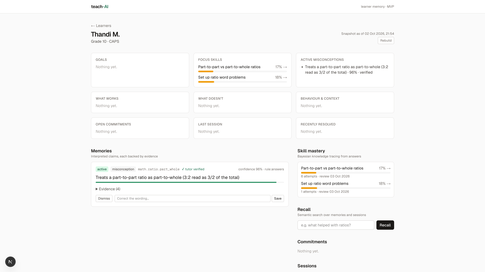

# teach-AI

A learner memory layer for tutoring platforms. teach-AI turns **platform events** (answers, hints, lessons) and **session transcripts** into an evidence-backed model of each student: what they know, what they get wrong, what helps them, what they've committed to. It then serves that model to AI tutors, human tutors and reports.

This is an MVP of the memory core: ingestion, processing, storage, serving, and a small UI for inspecting one learner.



## How it works

```text
Clients ──► POST /api/events ─────────────┐           ┌──► skill_states   (BKT mastery, spaced review)
            POST /api/sessions/:id/transcript         │    memories       (claims + status lifecycle)
                     │                    ▼           │    memory_evidence(why we believe each claim)
                     │             events (append-only)    commitments, episodes
                     ▼                    │           │
            transcript_segments           │           │
                     │                    ▼           │
                     │   Inngest: apply-learner-event ┤  fast path, plain code
                     └─► Inngest: process-transcript ─┤  slow path, LLM extraction → merge
                                                      ▼
                              Inngest: rebuild-learner-snapshot (debounced)
                                                      ▼
                        learner_snapshots ──► GET /api/learners/:id/snapshot
                        pgvector          ──► POST /api/learners/:id/recall
```

Three tiers:

1. **Sources** are what happened: `events`, `sessions`, `transcript_segments`. Rows are never edited. The only exception is the `events.processed_at` marker, which makes replays idempotent.
2. **Memory** is what we believe and why. `skill_states` holds numbers computed by code. `memories` holds qualitative claims. Every claim links to `memory_evidence` rows that point back at specific events, transcript segments or tutor actions.
3. **Snapshot** is a compact "student right now" document. It's rebuilt whenever memory changes and is what an AI tutor's prompt should consume.

### Key rules

- **The LLM never sets confidence.** Confidence is computed from evidence: a noisy-OR over supporting evidence, discounted by a noisy-OR over contradicting evidence (`src/lib/confidence.ts`).
- **Memories go through a lifecycle.** The statuses are `proposed`, `active`, `resolved` (misconceptions), `expired`, `dismissed` (by a tutor) and `superseded` (when edited). Edits create a new version instead of rewriting the old one.
- **Misconceptions resolve from behaviour.** Wrong answers tagged with a catalog misconception support it. Clean correct answers (no hints) on the same skill contradict it. When confidence drops below 0.25, the misconception is marked resolved.
- **Merging is deterministic code.** `src/lib/merge.ts` matches a new claim to an existing memory by catalog misconception id, then by embedding similarity, then by word overlap. It then adds, strengthens, weakens or retires. Memories a tutor dismissed are never revived.
- **Writes are serialized per learner.** Inngest runs one job at a time per learner, and every memory write takes a `SELECT … FOR UPDATE` lock on the learner row.
- **Erasure is one call.** `DELETE /api/learners/:id` cascades through every table, including embeddings.

## Stack

Next.js 16 (App Router) · Neon Postgres + pgvector · Drizzle ORM · Inngest (durable workflows) · Vercel AI SDK 7 via AI Gateway · Tailwind · Vitest

## Setup

```bash
pnpm install
cp .env.example .env.local      # set DATABASE_URL (+ AI_GATEWAY_API_KEY for transcripts/recall)
pnpm db:migrate
pnpm db:seed                    # skill taxonomy, misconception catalog, demo learner "Thandi M."
```

Run the app and the Inngest dev server in two terminals:

```bash
pnpm dev
pnpm inngest                    # dashboard at http://localhost:8288
```

If port 3000 is already taken, run both with the same port: `PORT=3001 pnpm dev` and `PORT=3001 pnpm inngest`.

Drive the pipeline the way a tutoring app would:

```bash
pnpm demo struggle   # wrong answers revealing the part-to-part ratio misconception
pnpm demo session    # a live session transcript → LLM extraction (needs AI_GATEWAY_API_KEY)
pnpm demo practice   # clean correct answers resolve the misconception; homework lesson closes a commitment
```

Set `TEACH_AI_URL=http://localhost:3001` if you're not on port 3000. Then open the learner page at `/learners/00000000-0000-4000-8000-000000000001`.

## API

| Method | Path | Purpose |
|---|---|---|
| `POST` | `/api/events` | One event or a batch of up to 100. Types: `question.answered`, `hint.requested`, `lesson.completed`. Send your own `id` to make retries idempotent. |
| `POST` | `/api/sessions` | Create a tutoring session. |
| `POST` | `/api/sessions/:id/transcript` | Upload diarized segments (`speaker`: `student` / `tutor` / `other`) and queue extraction. |
| `GET` | `/api/learners/:id/snapshot` | The current read model. |
| `POST` | `/api/learners/:id/recall` | `{ query, k }`: semantic search over memories and session summaries, ranked by similarity, recency and confidence. |
| `PATCH` | `/api/memories/:id` | Tutor `verify`, `dismiss` or `edit` (edit supersedes the memory). |
| `DELETE` | `/api/learners/:id` | Erase the learner and everything derived from them. |

When `TEACH_AI_API_KEY` is set, every route except `/api/inngest` requires `Authorization: Bearer <key>`.

## Scripts

`pnpm test` (unit tests for mastery, merge, confidence and claim sanitizing) · `pnpm typecheck` · `pnpm lint` · `pnpm db:generate` / `pnpm db:migrate`

## Not in the MVP yet

- **Audio pipeline.** Transcripts arrive already diarized. Recording upload, transcription and diarization still need to be added.
- **Auth and tenancy.** There's an optional single API key, and the UI's tutor actions have no login. Real tutor and parent accounts, `tenant_id` and row-level security are still to do.
- **Weekly and monthly episodes.** Session episodes are written; rolling them up into longer summaries isn't.
- **Evidence decay.** Old evidence counts as much as new evidence. Weighting by age would let regressions reactivate a resolved misconception sooner.
- **Late events.** Events are applied in arrival order. Knowledge tracing assumes time order, so a late event is applied as if it were the most recent.
- **Evaluation.** There's no extraction quality harness yet. The tutor dismissal rate is the intended metric.
